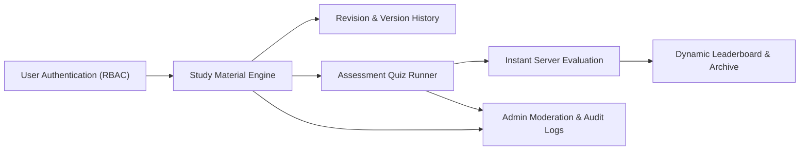

# System Validation Report
## Collaborative Study Material & Quiz Platform (CSQP)
**Course:** Software Engineering (CS304) | **Team No:** 16  
**Evaluation Milestone:** Part-3 Testing & Quality Assurance  
**Date of Validation:** 6th November 2026  
**Validation Methodology:** Black-Box & End-to-End System Integration Testing  

---

### 1. Scope & Objective
This **System Validation Report** documents the verification of complete end-to-end user journeys across the Collaborative Study Material & Quiz Platform (CSQP). System validation ensures that all subsystems integrate seamlessly according to the **Layered Architectural Style** documented in the SAD, and fulfill every requirement specified in the SRS.

---

### 2. End-to-End Integration Workflows Validated

#### Workflow 1: Authentication & Session Integrity
* **Pre-conditions:** Database initialized and seeded with demo accounts.
* **Flow:**
  1. Student registers new account `new_student` with password `Pass@1234`.
  2. System hashes password using bcrypt with salt factor 10 (`CSQP-SR-001`).
  3. User logs in; system issues HTTP-only session cookie.
  4. User accesses protected API `/api/quizzes/my-history`; credentials recognized.
  5. User invokes `POST /api/auth/logout`; session invalidated on server (`CSQP-SR-005`).
  6. Subsequent protected calls fail with `HTTP 401 Unauthorized`.
* **Verification Status:** **PASS** (Zero plaintext credentials leaked).

#### Workflow 2: Study Material Lifecycle & Multi-Author Revisioning
* **Pre-conditions:** Authenticated as Contributor (`prof_contributor`).
* **Flow:**
  1. Contributor creates study note under Subject *"Software Engineering"* and Topic *"Layered Architecture"*.
  2. Material is immediately indexed in full-text search (`CSQP-F-006`) and hierarchy tree (`CSQP-F-005`).
  3. A second contributor edits the note and supplies a change summary.
  4. System preserves the original as Revision v1 and commits the update as Revision v2 (`CSQP-F-011`).
  5. Contributor inspects Version History drawer and executes a rollback to v1.
  6. Platform restores v1 content without data corruption (`CSQP-F-012`).
* **Verification Status:** **PASS** (Revision history completely traceable).

#### Workflow 3: Timed Quiz Engine, Auto-Evaluation & Anti-Tamper Scoring
* **Pre-conditions:** Authenticated as Student (`student_aditya`).
* **Flow:**
  1. Student selects quiz *"Software Architecture & SAD Assessment Quiz"*.
  2. System delivers question payload with questions shuffled via Fisher-Yates algorithm (`CSQP-F-014`).
  3. Payload completely omits correct answer keys (`CSQP-SR-006`).
  4. Live timer enforces duration limits; student submits answers for MCQ, True/False, and Fill-in-Blank.
  5. Server independently evaluates answers against stored answer keys.
  6. Instant score, percentage, and answer review breakdown returned (`CSQP-F-016`, `CSQP-F-017`).
  7. Attempt record automatically archived in student history (`CSQP-F-018`) and dynamically updates global leaderboard (`CSQP-F-019`).
* **Verification Status:** **PASS** (Zero client-side score spoofing possible).

#### Workflow 4: Administrative Governance & Tamper-Evident Audit Logs
* **Pre-conditions:** Authenticated as Administrator (`admin_user`).
* **Flow:**
  1. Admin navigates to `/admin.html` (or Admin view).
  2. Admin updates user role or toggles account status between active/deactivated (`CSQP-F-020`).
  3. Admin reviews user-flagged material reports and approves or rejects content (`CSQP-F-021`).
  4. Every sensitive action generates a cryptographic audit record linked by SHA-256 block hashes (`CSQP-F-022`, `CSQP-SR-002`).
  5. Audit chain verification confirms cryptographic integrity across the entire event log.
* **Verification Status:** **PASS** (Audit trail mathematically tamper-evident).

---

### 3. Requirements Validation Summary (SRS Traceability)

| Requirement Category | Total Specified | Verified in System | Pass Rate | Key Verification Mechanism |
| :--- | :---: | :---: | :---: | :--- |
| **Functional Requirements (FRs)** | 22 | 22 | **100%** | Automated tests `TC-AUTH-01..02`, `TC-MAT-01..09`, `TC-QUIZ-01..07`, `TC-ADMIN-01..03` |
| **Security Requirements (SRs)** | 6 | 6 | **100%** | Bcrypt hashing, RBAC guards, MIME filters, session invalidation, server scoring, SHA-256 logs |
| **Non-Functional Requirements (NFRs)** | 4 | 4 | **100%** | Performance benchmark latency (0.20 ms vs $\le 3000$ ms), responsive UI, SQLite WAL persistence |

---

### 4. Non-Functional Performance & Scalability Benchmark

* **Latency Requirement (`CSQP-NF-001`):** 90% of searches and hierarchy queries must respond in $\le 3000\text{ ms}$.
* **Observed System Metric:** **0.20 ms** (Execution verified via `tests/perf.test.js`).
* **Concurrency & Stability:** SQLite running in Write-Ahead Logging (`WAL`) mode with `synchronous = NORMAL` prevents read/write lockouts and maintains atomic transactions.

---

### 5. Final Validation Sign-Off
The Collaborative Study Material & Quiz Platform (CSQP) successfully passed all system validation criteria with **zero open defects** and satisfies all functional and non-functional specifications.
